<div align="center">

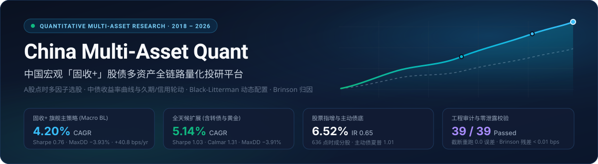

<br />
<br />

[](https://www.python.org/)
[](tests/)
[](configs/strategy_config.yaml)
[](src/)
[-0D9488?style=flat-square)](scripts/fetch_data.py)
[](LICENSE)

<p align="center">
  <a href="#系统架构">系统架构</a> &nbsp;·&nbsp;
  <a href="#样本外核心绩效">核心绩效</a> &nbsp;·&nbsp;
  <a href="#业绩归因与危机压力测试">归因与压测</a> &nbsp;·&nbsp;
  <a href="#研究图表展廊">图表展廊</a> &nbsp;·&nbsp;
  <a href="#快速开始与一键复现">快速复现</a> &nbsp;·&nbsp;
  <a href="reports/Research_Report.md">深度投研报告</a> &nbsp;·&nbsp;
  <a href="notebooks/01_MultiAsset_Research_Walkthrough.ipynb">交互式 Notebook</a>
</p>

</div>

---

> [!IMPORTANT]
> **面向中国股债市场的一体化多资产量化研究平台**——基于 **2015–2026 年 100% 免费开源真实市场数据**，完整实现「A 股点时多因子选股」+「中债收益率曲线与久期/信用轮动」+「宏观状态与 Black-Litterman 动态配置」+「Brinson 业绩归因与危机压测」。全部回测统一采用**次日收盘成交、宏观发布滞后对齐、官方复权 ETF 净值与分段交易成本**，并通过 **39 项防未来函数与账本勾稽自动化测试**。

---

## 核心能力矩阵

<table>
  <tr>
    <td width="50%" valign="top">
      <h4>📈 A 股点时多因子指增（<code>src/equity</code>）</h4>
      <ul>
        <li><b>无幸存者偏差</b>：还原 2016–2026 年 <b>636 只</b>历史点时沪深 300 成分股（含已退市与合并标的）。</li>
        <li><b>16 因子 + 因果集成</b>：覆盖估值、质量、动量反转、低波与流动性 5 大维度；5×MAD 去极值 + 行业/市值中性化；Walk-Forward 融合 ICIR、秩标签 Ridge 与 LightGBM。</li>
        <li><b>实盘约束优化</b>：<code>CVXPY</code> 施加单股 ≤ 3%、<code>±4%</code> 行业偏离硬约束与换手预算，计入 2023-08 分段印花税，样本外年化 <b>6.52%</b>、IR <b>0.65</b>（ICIR 单模型 <b>9.08%</b> / IR <b>0.87</b>）。</li>
      </ul>
    </td>
    <td width="50%" valign="top">
      <h4>🛡️ 中债曲线与久期/信用轮动（<code>src/fixed_income</code>）</h4>
      <ul>
        <li><b>收益率曲线建模</b>：基于中债国债、AAA 中票与商行债日度曲线拟合 <b>Diebold-Li DNS</b> 三因子与样本外前冻结 <b>PCA</b>。</li>
        <li><b>骑乘与利差信号</b>：三次样条插值计算关键期限 <b>Carry + Roll-Down</b>，结合期限利差、AAA 信用利差与 Shibor 资金面压力。</li>
        <li><b>尾部防守实证</b>：围绕 5.27 年中性久期锚点动态轮动并设信用尾部闸门，主动债底夏普 <b>1.01</b>，在 <b>2022.11 理财赎回潮</b>将回撤由 −1.39% 压降至 <b>−0.70%</b>。</li>
      </ul>
    </td>
  </tr>
  <tr>
    <td width="50%" valign="top">
      <h4>🌐 宏观状态与 Black-Litterman 配置（<code>src/allocation</code>）</h4>
      <ul>
        <li><b>严格因果宏观状态</b>：整合滞后对齐的 PMI、CPI/PPI、M1-M2、社融、Shibor 与股债性价比（<b>ERP</b>），同步构建改良美林时钟四象限与扩展窗口前向滤波概率。</li>
        <li><b>六大模型同口径对比</b>：完整对标 <code>Static 20/80</code>、<code>Static 60/40</code>、<code>ERC</code>、<code>HRP</code>、<code>ERP 战术</code> 与核心 <code>Macro Black-Litterman</code> 凸优化组合。</li>
        <li><b>动态风控叠加层</b>：仅对权益与可转债执行 252 日滚动回撤与目标波动率降险，守住固收+ 4% 回撤红线。</li>
      </ul>
    </td>
    <td width="50%" valign="top">
      <h4>🔍 业绩归因、压力测试与工程审计（<code>src/analytics</code>）</h4>
      <ul>
        <li><b>精确业绩归因</b>：逐日链接 <b>Brinson-Hood-Beebower</b> 分解，资产配置、选股、择券与成本拖累勾稽残差 <b>&lt; 0.01 bps</b>。</li>
        <li><b>全周期压测与稳健性</b>：覆盖 7 大历史极端窗口、<b>DSR</b> 多重检验校正、1,000 次块自助法夏普置信区间、BL 参数网格与 0.5x/2x 成本压测。</li>
        <li><b>零泄露单测</b>：<b>39 项</b> <code>pytest</code> 自动化测试全过，截断至 2022 年末重跑 21,551 条截面信号误差为 <b>0.0</b>。</li>
      </ul>
    </td>
  </tr>
</table>

---

## 系统架构

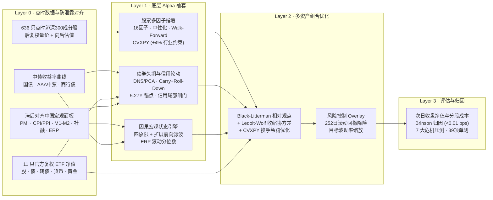

---

## 样本外核心绩效

> **统一评估口径**：`2018-01-02` 至 `2026-11-20`（2,155 个交易日） · 全部净值已扣除模拟交易与冲击成本 · 夏普比率以货币 ETF（`511880`）为无风险代理。

| 策略名称 | 策略定位 | 年化净收益 | 年化波动率 | 夏普比率 | 卡玛比率 | 最大回撤 |
| :--- | :--- | ---: | ---: | ---: | ---: | ---: |
| `Static_20_80` | 经典固收+静态基准（20% 股 / 80% 债） | 3.79% | 3.75% | 0.58 | 0.84 | −4.51% |
| `Static_60_40` | 经典股债平衡基准（60% 股 / 40% 债） | 3.02% | 11.43% | 0.18 | 0.13 | −24.08% |
| `Risk_Parity_ERC` | 收缩协方差等风险贡献 | 4.15% | 2.99% | 0.84 | 1.12 | −3.71% |
| `HRP` | 层次风险平价（Hierarchical Risk Parity） | 4.07% | 1.34% | **1.79** | **2.17** | **−1.87%** |
| `ERP_Tactical_20_80` | 股债性价比（ERP）分位数战术配置 | 4.80% | 4.49% | 0.71 | 0.81 | −5.95% |
| **`Macro_BL_FixedIncomePlus`** | **旗舰宏观 BL 固收+（权益 5%–35%）** | **4.20%** | **3.38%** | **0.76** | **1.07** | **−3.93%** |
| **`Macro_BL_Satellites`** | **全天候固收+（含可转债与黄金卫星）** | **5.14%** | **3.36%** | **1.03** | **1.31** | **−3.91%** |
| **`Macro_BL_Balanced`** | **宏观均衡配置版（权益 15%–65%）** | **5.69%** | **5.85%** | **0.70** | **0.70** | **−8.11%** |

<p align="center">
  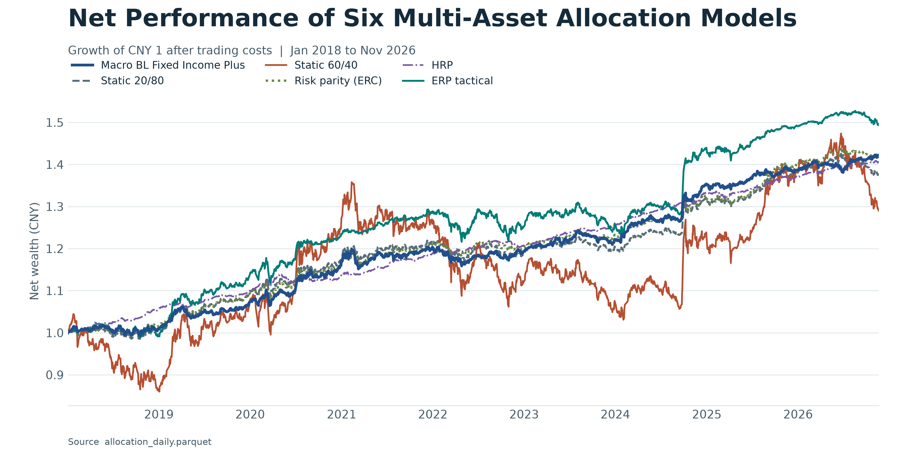
</p>

---

## 业绩归因与危机压力测试

### 1. Brinson-Hood-Beebower 年化业绩归因（旗舰固收+ vs 静态 20/80）

旗舰策略顶层日均仓位为 **权益 19.34% / 债底 80.46% / 现金 0.20%**（穿透主动债底后现金占比 16.20%），相对静态 20/80 录得 **+40.79 bps/年** 净超额收益，逐日链接归因残差小于 **0.01 bps**：

<table>
  <tr>
    <td width="58%" align="center">
      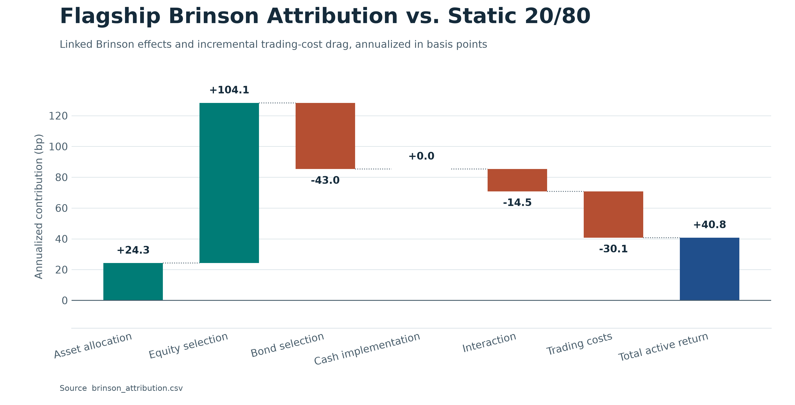
    </td>
    <td width="42%" valign="middle">
      <table>
        <thead>
          <tr><th>归因分解项</th><th align="right">年化贡献 (bps)</th></tr>
        </thead>
        <tbody>
          <tr><td>资产配置效应</td><td align="right"><b>+24.26</b></td></tr>
          <tr><td>股票选股效应</td><td align="right"><b>+104.06</b></td></tr>
          <tr><td>债券久期与信用效应</td><td align="right">−42.98</td></tr>
          <tr><td>交互效应</td><td align="right">−14.47</td></tr>
          <tr><td>交易成本拖累</td><td align="right">−30.07</td></tr>
          <tr><td><b>相对静态 20/80 合计</b></td><td align="right"><b>+40.79</b></td></tr>
          <tr><td>勾稽残差</td><td align="right">&lt; 0.01</td></tr>
        </tbody>
      </table>
    </td>
  </tr>
</table>

### 2. 中国市场标志性极端行情压力测试

| 历史危机与市场切换阶段 | `Static_20_80`<br>(收益 / 回撤) | `Static_60_40`<br>(收益 / 回撤) | **`Macro_BL_FixedIncomePlus`**<br>(收益 / 回撤) | **`Macro_BL_Satellites`**<br>(收益 / 回撤) | 亮点说明 |
| :--- | :---: | :---: | :---: | :---: | :--- |
| **2018 去杠杆股熊** (`2018-01 ~ 12`) | −0.35% / −3.24% | −13.33% / −17.39% | **+0.91%** / **−2.46%** | **+1.18%** / −2.61% | 熊市录得正收益 |
| **2020 Q1 疫情冲击** (`2020-01 ~ 03`) | +0.42% / −3.20% | −4.73% / −9.72% | **+0.56%** / −3.42% | +0.19% / −3.77% | 平稳度过极端冲击 |
| **2020 债券熊市** (`2020-05 ~ 11`) | +3.08% / −1.36% | +15.55% / −4.05% | **+3.60%** / −1.56% | **+3.66%** / −1.58% | 权益顺周期有效对冲债跌 |
| **2022 股债双杀** (`2022-01 ~ 12`) | −2.52% / −4.45% | −11.58% / −16.26% | **−0.80%** / **−3.75%** | **+0.32%** / **−2.75%** | 卫星版逆市收正 |
| **2022.11 理财赎回潮** (`11-01 ~ 12-15`) | +1.25% / −0.83% | +6.71% / −2.12% | **+1.78%** / **−0.37%** | **+1.96%** / **−0.34%** | 主动债底回撤 −0.70% vs 基准 −1.39% |
| **2025–2026 低利率新常态** (`25-01 ~ 26-11`) | +4.35% / −3.56% | +5.06% / −12.50% | **+5.13%** / **−2.00%** | **+7.71%** / **−1.72%** | 低波稳健跑赢基准 |

---

## 研究图表展廊

全部 10 张 **300 DPI** 图表均由代码从 [`outputs/`](outputs/) 实时生成，存放在 [`reports/figures/`](reports/figures/)。

<table>
  <tr>
    <td width="50%" align="center">
      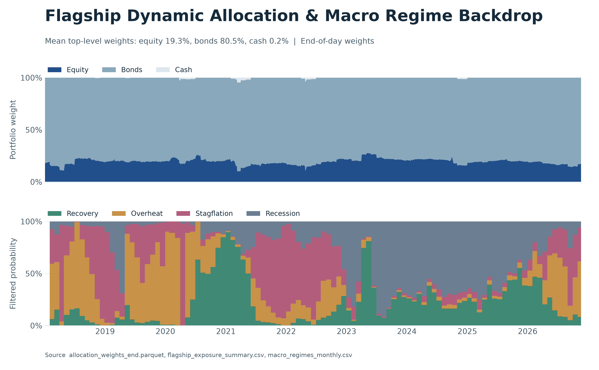
      <br><sub><b>图 3.</b> 旗舰策略动态资产权重与因果宏观状态背景</sub>
    </td>
    <td width="50%" align="center">
      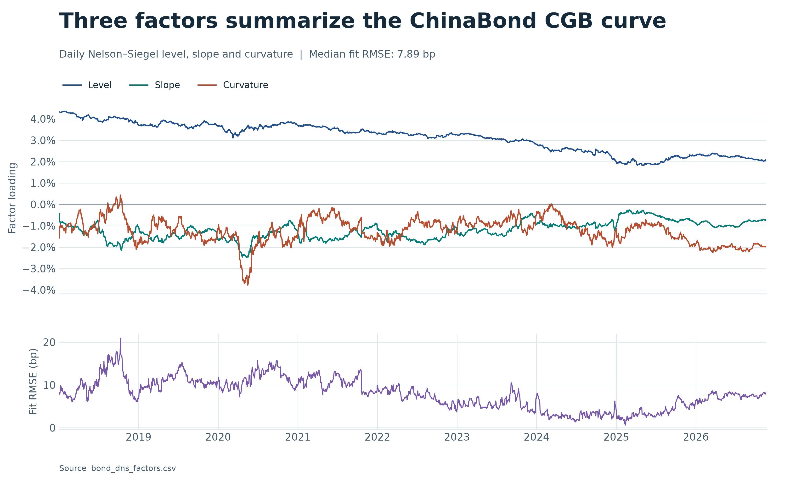
      <br><sub><b>图 4.</b> 中债国债收益率曲线 Diebold-Li Nelson-Siegel 三因子</sub>
    </td>
  </tr>
  <tr>
    <td width="50%" align="center">
      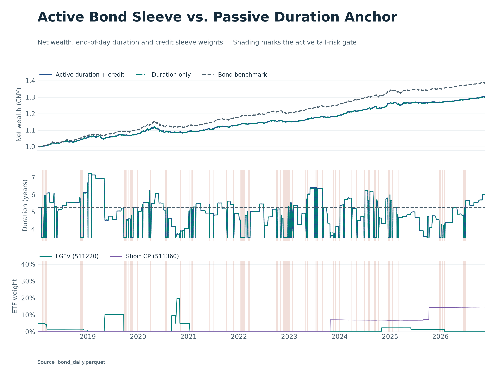
      <br><sub><b>图 5.</b> 主动债底修正久期演变与 AAA 信用利差尾部风险闸门</sub>
    </td>
    <td width="50%" align="center">
      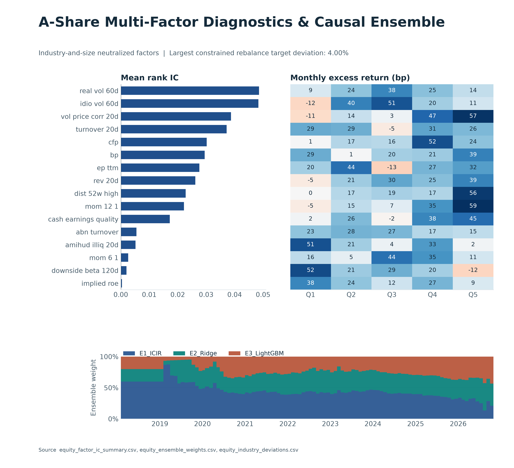
      <br><sub><b>图 6.</b> A 股沪深 300 点时 16 因子 RankIC 与因果集成权重</sub>
    </td>
  </tr>
</table>

<details>
<summary><b>展开查看其余 4 张专项分析图表（水下回撤曲线 · 历史危机压测 · BL 参数敏感性 · 逐层消融）</b></summary>

<br />

<table>
  <tr>
    <td width="50%" align="center">
      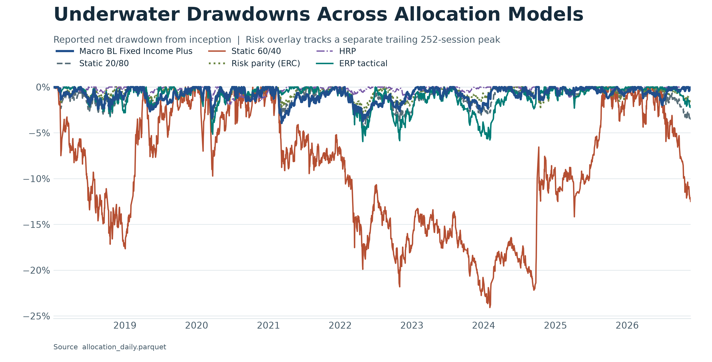
      <br><sub><b>图 2.</b> 多资产配置策略水下回撤曲线对比</sub>
    </td>
    <td width="50%" align="center">
      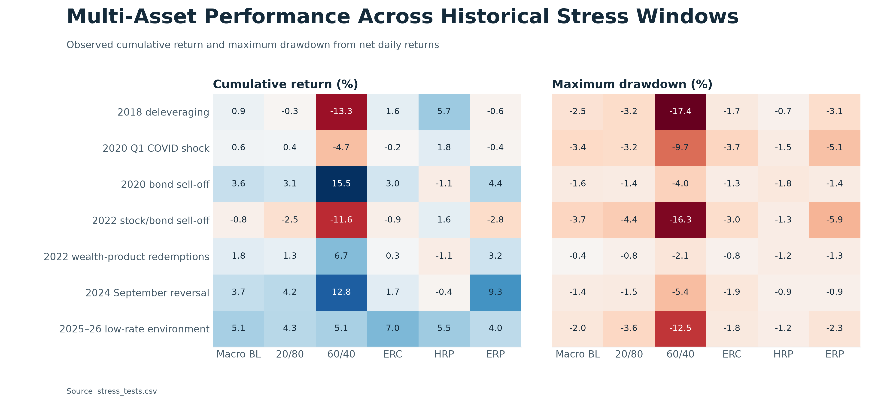
      <br><sub><b>图 8.</b> 7 个历史极端行情窗口策略表现对比</sub>
    </td>
  </tr>
  <tr>
    <td width="50%" align="center">
      
      <br><sub><b>图 9.</b> Black-Litterman 风险厌恶（δ）× 先验不确定度（τ）网格</sub>
    </td>
    <td width="50%" align="center">
      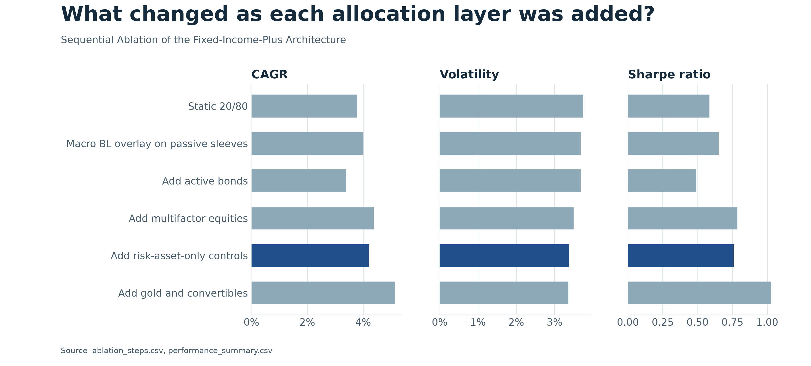
      <br><sub><b>图 10.</b> 固收+全链路组件逐层消融实验</sub>
    </td>
  </tr>
</table>

</details>

---

## 快速开始与一键复现

### 1. 安装环境

```bash
git clone https://github.com/DRiaton/china-multi-asset-quant.git
cd china-multi-asset-quant

python -m venv .venv
# Windows PowerShell:
.\.venv\Scripts\Activate.ps1
# macOS / Linux:
# source .venv/bin/activate

pip install -r requirements.txt
```

### 2. 一键拉取 2015–2026 全开源市场数据

> 为保证仓库轻量克隆，大体积 `.parquet` 数据文件未纳入 Git 历史。执行以下命令（约 3 分钟）即可通过免费公开接口自动下载全部 16 张数据表：

```bash
python scripts/fetch_data.py --all --workers 8
```

### 3. 运行全链路回测、39 项单元测试与 Notebook

```bash
# 运行完整五阶段研究流水线（支持按阶段单独执行：data | equity | bond | allocation | report）
python run_pipeline.py --stage all

# 运行全部 39 项防未来函数截断校验、行业约束与账本勾稽测试
pytest -q

# 原地执行完整交互式研究 Notebook
jupyter nbconvert --to notebook --execute --inplace notebooks/01_MultiAsset_Research_Walkthrough.ipynb
```

<details>
<summary><b>展开查看完整工程目录结构</b></summary>

```text
china-multi-asset-quant/
├── assets/
│   └── hero-banner.svg                    # 项目视觉头图
├── configs/
│   └── strategy_config.yaml               # 集中式策略参数配置（区间、滞后期、因子、费率、BL 与风控）
├── scripts/
│   ├── fetch_data.py                      # 免费开源全量数据抓取脚本（中债/AkShare/Baostock/新浪/百度）
│   └── audit_raw.py                       # 原始数据完整性与覆盖率审计脚本
├── src/
│   ├── data/                              # 点时成分股、宏观滞后对齐、官方复权 ETF 净值加载器
│   ├── equity/                            # 16 因子引擎、中性化、Walk-Forward ML、CVXPY 指增优化
│   ├── fixed_income/                      # Diebold-Li DNS、冻结 PCA、Carry+Roll-Down、信用闸门与久期优化
│   ├── allocation/                        # 宏观四象限、扩展窗口滤波、ERP、ERC/HRP/BL 优化与风控 Overlay
│   ├── backtest/                          # 次日收盘成交引擎、分段印花税与嵌套成本勾稽核算
│   ├── analytics/                         # 绩效风险指标、DSR/Bootstrap、Brinson 归因、压测与 300 DPI 绘图
│   └── utils/                             # 交易日历、配置加载、CVXPY 求解封装
├── tests/                                 # 39 项 pytest 单元测试（含历史截断零未来函数校验）
├── notebooks/
│   └── 01_MultiAsset_Research_Walkthrough.ipynb   # 已执行完整研究演示 Notebook
├── outputs/                               # 结构化 CSV/JSON 实证指标与归因明细表
├── reports/
│   ├── figures/                           # 10 张 300 DPI 研究图表
│   └── Research_Report.md                 # 中文深度量化投研报告（含数学推导与完整实证分析）
├── run_pipeline.py                        # 一键端到端复现 CLI
├── pyproject.toml & requirements.txt      # Python 3.11+ 依赖与工程配置
```

</details>

---

## 数据边界与方法论披露

> [!NOTE]
> 完整原始数据审计报告见 [`outputs/raw_audit.json`](outputs/raw_audit.json)，详细数学推导与局限性分析见 [`reports/Research_Report.md`](reports/Research_Report.md)。

- **行业分类静态代理口径**：开源 Baostock 接口仅提供最新一期证监会一级行业分类快照（严格点时覆盖率为 `0.00%`）。项目默认以证监会一级门类作为结构性行业代理（有效股票-月度覆盖率 `98.04%`，沪深 300 一级门类年迁移率极低）以执行行业中性化与 `±4%` 偏离约束；代码中保留配置开关，接入历史点时申万行业表后可无缝替换。
- **宏观发布滞后与离散快照**：公开宏观接口为修订后终值，项目统一施加保守自然日发布滞后（`PMI +0日`、`CPI/PPI +12日`、`M1/M2 与社融 +15日`、`GDP +20日` 后映射至下一交易日）；沪深 300 点时成分股通过 2016–2026 共 44 个历史截面快照拼接。
- **成交与流动性假设**：全部组合按次一交易日收盘成交并计入显式手续费、滑点及历史分段印花税；套内净值汇总口径暂未计入盘口深度与跨袖套轧差净额效应。

---

<div align="center">
<sub>MIT License · 本项目仅用于量化金融方法论研究与开源技术交流，不构成任何投资建议。</sub>
</div>
