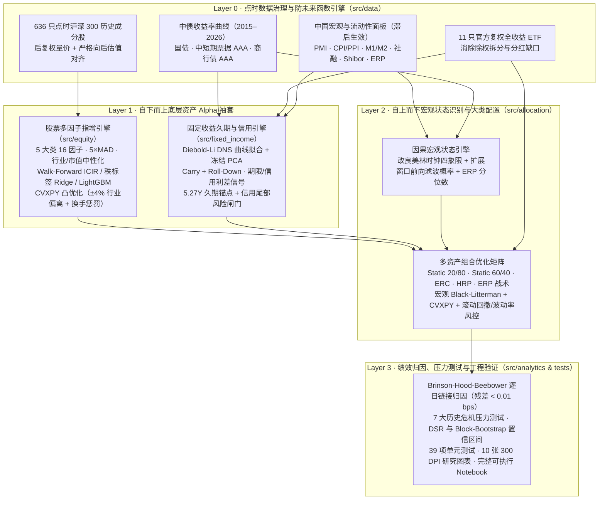
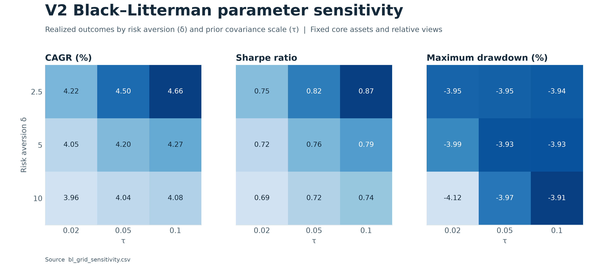

<div align="center">

# 中国宏观状态驱动的「固收+」股债多资产量化投研平台

### China Macro-Regime Fixed-Income-Plus & Multi-Asset Quantitative Research Platform

[](https://www.python.org/)
[](tests/)
[](configs/strategy_config.yaml)
[](src/)
[](outputs/performance_summary.csv)
[](tests/test_no_lookahead.py)
[](scripts/fetch_data.py)
[](LICENSE)

<p>
  <b>面向中国股债市场的一体化多资产量化研究框架：打通「A 股点时多因子选股」+「中债收益率曲线与久期/信用轮动」+「宏观状态与 Black-Litterman 动态配置」+「Brinson 业绩归因与危机压力测试」全链路。</b>
</p>
<p>
  <a href="#-核心研究亮点与实证结果">核心亮点</a> •
  <a href="#-系统四层投研架构">系统架构</a> •
  <a href="#-样本外全景绩效与压力测试">样本外绩效</a> •
  <a href="#-v1--v2-归因诊断与机理迭代">V1 → V2 迭代</a> •
  <a href="#-核心图表展廊">图表展廊</a> •
  <a href="#-目录结构与一键复现">一键复现</a> •
  <a href="#-数据边界与方法论披露">数据边界</a>
</p>

</div>

---

## 🎯 核心研究亮点与实证结果

本项目基于 **2015–2026 年全开源免费中国市场数据**（中债收益率曲线、官方复权 ETF 净值、636 只历史点时沪深 300 成分股及中国宏观面板），构建了一套模块化、严格防未来函数、全流程扣费的「固收+」与多资产量化配置研究平台。样本外统一评估区间为 **`2018-01-02` 至 `2026-11-20`（共 2,155 个交易日）**，完整穿越 2018 去杠杆股熊、2020 疫情冲击与债熊、2022 股债双杀与 11 月理财赎回潮、2024.9.24 反转及 2025–2026 低利率新常态。

| 研究模块 | 样本外核心指标（扣费后） | 对照基准表现 | 关键工程与风控机制 |
| :--- | :--- | :--- | :--- |
| **🏆 旗舰策略 `Macro_BL_FixedIncomePlus`**<br>宏观 Black-Litterman 固收+ | 年化 **4.20%** · 夏普 **0.76**<br>最大回撤 **−3.93%** · 卡玛 **1.07** | 跑赢静态 20/80 **+40.79 bps/年**<br>夏普 +0.18，回撤收窄 58 bps | 核心满仓 BL + 252 日滚动回撤风控 + Brinson 归因残差 `< 0.01 bps` |
| **🌟 全天候扩展 `Macro_BL_Satellites`**<br>叠加可转债与黄金卫星资产 | 年化 **5.14%** · 夏普 **1.03**<br>最大回撤 **−3.91%** · 卡玛 **1.31** | 2022 股债双杀录得 **+0.32%** 正收益 | 卫星 ETF 满 60 个交易日后动态纳入，杜绝上市初期泄露 |
| **⚖️ 均衡配置 `Macro_BL_Balanced`**<br>权益走廊 15%–65% 股债平衡版 | 年化 **5.69%** · 夏普 **0.70**<br>最大回撤 **−8.11%** | 全面领先静态 60/40（年化 **3.02%**、夏普 **0.18**、回撤 **−24.08%**） | 9% 事前年化波动预算 + 滚动回撤分层降险 |
| **📈 股票底层 `Equity_Alpha_Sleeve`**<br>沪深 300 点时多因子指增 | 集成年化 **6.52%** · **IR 0.65**<br>`E1_ICIR` 单模型 **9.08%** · **IR 0.87** | 同期沪深 300 基准 **−0.39%/年**<br>年化单边换手压降至 **254.5%** | **636 只点时历史成分股**（含退市/合并）+ `±4%` 行业偏离硬约束 + 2023-08 分段印花税 |
| **🛡️ 债券底层 `Bond_Active_Sleeve`**<br>中债曲线建模与久期/信用轮动 | 年化 **3.15%** · 夏普 **1.01**<br>2022.11 理财赎回潮仅回撤 **−0.70%** | 赎回潮窗口回撤较静态债底（**−1.39%**）**直接减半** | Diebold-Li DNS + 冻结 PCA + Carry/Roll-Down + AAA 信用利差尾部闸门 |

> **严谨性声明**：全部回测严格采用**次一交易日收盘成交**、**宏观数据发布滞后对齐**、**官方复权 ETF 净值**与**真实分段交易成本**（A 股印花税按 `2023-08-28` 前 10 bps / 后 5 bps 计提，股票双边佣金 2.5 bps + 滑点 5 bps，ETF 单边 3 bps），并通过 **39 项 `pytest` 自动化防泄露与账本勾稽测试**（截断历史至 2022 年末重跑，21,551 条股票截面信号与集成权重最大误差均为 `0.0`）。

---

## 🏗️ 系统四层投研架构



### 四大核心模块设计概要

1. **A 股点时多因子选股与指增（`src/equity/`）**
   - 围绕**估值**（`EP`、`BP`、`CFP`）、**质量盈利**（`隐含 ROE`、`盈利现金含金量`）、**动量反转**（`12-1 动量`、`6-1 动量`、`20 日反转`、`距 52 周高点`）、**低波防御**（`60 日波动率`、`特质波动率`、`下行 Beta`）与**流动性量价**（`换手率`、`异常换手`、`Amihud 非流动性`、`量价相关性`）构建 16 个截面因子。
   - 经 5×MAD 去极值、证监会一级行业与对数市值 OLS 残差中性化后，以严格 Walk-Forward（带 1 个月 purge 隔离期）分别训练线性 **ICIR**、截面秩标签 **Ridge** 与 **LightGBM**，按已成熟样本外 RankIC 做因果贝叶斯收缩集成，再经 `cvxpy` 求解满足单股上限 3%、有效持仓 $\ge 40$ 只、`±4%` 行业偏离与换手预算的纯多头指增组合。
2. **中债收益率曲线建模与债券轮动（`src/fixed_income/`）**
   - 对每日中债国债曲线拟合 **Diebold-Li 动态 Nelson-Siegel（DNS）** 三因子（水平 $\beta_1$、斜率 $\beta_2$、曲率 $\beta_3$）并配合样本外前冻结 **PCA** 交叉验证。
   - 基于三次样条插值计算关键期限 **1 个月 Carry + Roll-Down（票息 + 骑乘收益）**，叠加 `10Y-1Y`/`10Y-3Y` 期限利差、`MTN_AAA - CGB` 信用利差与 `Shibor` 资金面压力指标，构建理论恒定久期全收益指数校验 ETF 跟踪误差，并在真实复权债券 ETF 池（5Y/10Y/30Y 国债、城投信用、短融、货币现金）上围绕 **5.27 年**中性久期锚点做主动久期与信用轮动。
3. **宏观状态识别与 Black-Litterman 配置（`src/allocation/`）**
   - 合成严格滞后对齐的中国**增长、通胀、流动性**三大宏观维度与**股债性价比（`ERP = 1/PE_TTM − 10Y国债收益率`）**，同步运行改良美林时钟四象限与扩展窗口前向滤波概率模型（严禁使用含未来信息的平滑后验概率）。
   - 将宏观状态、ERP 与债市观点转化为**相对债券的 Black-Litterman 观点矩阵**，由 `cvxpy` 在核心满仓约束与换手惩罚下求解权重，并叠加仅作用于权益与可转债的 **252 日滚动回撤与目标波动率风控层**。
4. **归因、压力测试与稳健性检验（`src/analytics/`, `tests/`）**
   - 逐日链接 **Brinson-Hood-Beebower** 归因，精确拆解资产配置、股票选股、债券增强、交互效应与交易成本拖累（残差 `< 0.01 bps`）。
   - 系统输出 **7 个中国市场标志性危机阶段压力测试**、**Deflated Sharpe Ratio（DSR）**、**1,000 次块自助法（Block-Bootstrap）95% 夏普置信区间**、BL 参数网格热力图与 0.5x/1x/2x 交易成本敏感性检验。

---

## 📊 样本外全景绩效与压力测试

**样本区间**：`2018-01-02` 至 `2026-11-20`（2,155 个交易日） · **收益口径**：扣除模拟交易成本 · **无风险代理**：货币 ETF（`511880`）。

### 1. 多资产配置模型全景对比

| 策略名称 | 策略定位 | 年化净收益 | 年化波动率 | 夏普比率 | 卡玛比率 | 最大回撤 | 顶层日均仓位结构 |
| :--- | :--- | ---: | ---: | ---: | ---: | ---: | :--- |
| `Static_20_80` | 经典固收+静态基准 | 3.79% | 3.75% | 0.58 | 0.84 | −4.51% | 20% 权益 / 80% 债底 |
| `Static_60_40` | 经典股债 60/40 基准 | 3.02% | 11.43% | 0.18 | 0.13 | −24.08% | 60% 权益 / 40% 债底 |
| `Risk_Parity_ERC` | 收缩协方差等风险贡献 | 4.15% | 2.99% | 0.84 | 1.12 | −3.71% | 动态风险平价 |
| `HRP` | 层次风险平价 | 4.07% | 1.34% | **1.79** | **2.17** | **−1.87%** | 低波债券主导 |
| `ERP_Tactical_20_80` | ERP 分位数战术 20/80 | 4.80% | 4.49% | 0.71 | 0.81 | −5.95% | 5%–35% 被动权益 |
| **`Macro_BL_FixedIncomePlus`** | **旗舰宏观 BL 固收+** | **4.20%** | **3.38%** | **0.76** | **1.07** | **−3.93%** | **19.3% 权益 / 80.5% 债底 / 0.2% 现金** |
| **`Macro_BL_Satellites`** | **含转债与黄金全天候固收+** | **5.14%** | **3.36%** | **1.03** | **1.31** | **−3.91%** | 股 + 债 + 转债 + 黄金 |
| **`Macro_BL_Balanced`** | **宏观均衡配置版（15%–65%）** | **5.69%** | **5.85%** | **0.70** | **0.70** | **−8.11%** | 40/60 锚点 + BL + 风控 |


### 2. 中国市场标志性极端行情压力测试

| 历史危机与切换阶段 | `Static_20_80`（收益 / 回撤） | `Static_60_40`（收益 / 回撤） | **`Macro_BL_FixedIncomePlus`** | **`Macro_BL_Satellites`** | 债券袖套专项对比 |
| :--- | :---: | :---: | :---: | :---: | :---: |
| **2018 去杠杆股熊**<br>`2018-01` – `2018-12` | −0.35% / −3.24% | −13.33% / −17.39% | **+0.91%** / **−2.46%** | **+1.18%** / −2.61% | 主动债底 +5.72% |
| **2020 Q1 疫情冲击**<br>`2020-01` – `2020-03` | +0.42% / −3.20% | −4.73% / −9.72% | **+0.56%** / −3.42% | +0.19% / −3.77% | 主动债底 +2.64% |
| **2020 债券熊市**<br>`2020-05` – `2020-11` | +3.08% / −1.36% | +15.55% / −4.05% | **+3.60%** / −1.56% | **+3.66%** / −1.58% | 主动债底 −2.90%（静态 −2.81%） |
| **2022 股债双杀**<br>`2022-01` – `2022-12` | −2.52% / −4.45% | −11.58% / −16.26% | **−0.80%** / **−3.75%** | **+0.32%** / **−2.75%** | 主动债底 +1.68% / 回撤 −0.83% |
| **2022.11 理财赎回潮**<br>`2022-11-01` – `2022-12-15` | +1.25% / −0.83% | +6.71% / −2.12% | **+1.78%** / **−0.37%** | **+1.96%** / **−0.34%** | **−0.70% vs −1.39%（回撤砍半）** |
| **2025–2026 低利率新常态**<br>`2025-01` – `2026-11` | +4.35% / −3.56% | +5.06% / −12.50% | **+5.13%** / **−2.00%** | **+7.71%** / **−1.72%** | 主动债底 +3.26% / 回撤 −1.51% |

---

## 🔬 V1 → V2 归因诊断与机理迭代

本仓库完整保留了从 V1 到 V2 的实证诊断记录（[v1_baseline_snapshot.json](outputs/v1_baseline_snapshot.json)）。在 V1 初始版本中，旗舰策略年化净收益仅 **2.16%**（夏普 **0.18**，跑输静态 20/80 达 **−163.07 bps/年**）。通过 Brinson 归因与持仓穿透诊断，定位出四项金融建模层面的结构性缺陷，并在**不进行事后网格挑参**的前提下从金融机理完成 V2 重构：

1. **消除 Black-Litterman 现金泄漏（顶层日均现金 `68.95%` → `0.20%`）**：V1 将零波动现金直接作为无约束资产放入超额收益 BL 优化器，低波动中债的均衡先验收益仅约 13 bps，稍有看空观点即触发债券大比例清仓。V2 将 BL 限定在核心投资资产池并构造**相对债券的观点矩阵**，由债底承担固收+底座职能。
2. **解除回撤风控“现金锁定陷阱”（水下 1,325 天 → 最大回撤收窄至 −3.93%）**：V1 按全期历史最高点计算回撤并同步缩减 80% 债底，导致净值长期难以修复。V2 改用 **252 个交易日滚动高点回撤**，仅压降权益与可转债风险敞口，释放权重由债底与现金各承接 50%。
3. **校准债券久期锚点与信用尾部闸门（主动债底 `2.37%` → `3.15%`，夏普 `0.62` → `1.01`）**：V1 的 6 bps 信用走阔阈值过于敏感，频繁将久期压至 1.0 年。V2 围绕 **5.27 年**基准久期设防（`2.8Y–8.5Y`），并将信用闸门收紧至 `95% 分位 / ≥15 bps` 尾部冲击，在保留 2022.11 赎回潮防守效果的同时大幅减少常态踏空。
4. **修正股票截面 ML 标签与行业中性约束（集成 `2.93% / IR 0.33` → `6.52% / IR 0.65`，换手 `514%` → `254.5%`）**：V1 直接用 MSE 拟合未截尾原始个股收益且机械等权融合。V2 改用**截面秩标准化标签**训练 Ridge/LightGBM，采用**已兑现样本外 RankIC 因果收缩集成**（平均权重 `E1 45.1% / E2 30.1% / E3 24.8%`），并启用 `±4%` 证监会一级行业偏离约束与换手预算。

| 核心对比指标 | V1 基线 | V2 重构后 | 改善幅度（V2 − V1） |
| :--- | ---: | ---: | ---: |
| **旗舰 `Macro_BL_FixedIncomePlus` · 年化净收益** | 2.16% | **4.20%** | **+2.04%** |
| **旗舰 · 夏普比率 / 卡玛比率** | 0.18 / 0.38 | **0.76 / 1.07** | **+0.58 / +0.69** |
| **旗舰 · 最大回撤** | −5.66% | **−3.93%** | **收窄 1.73%** |
| **旗舰顶层日均现金仓位（穿透现金）** | 68.95% | **0.20%**（16.20%） | **−68.76%** |
| **Brinson · 资产配置效应** | −162.45 bps | **+24.26 bps** | **+186.71 bps** |
| **Brinson · 股票选股效应** | +52.90 bps | **+104.06 bps** | **+51.16 bps** |
| **Brinson · 相对静态 20/80 合计超额** | −163.07 bps | **+40.79 bps** | **+203.86 bps** |
| **股票集成 · 年化 / IR / 年化单边换手** | 2.93% / 0.33 / 514% | **6.52% / 0.65 / 254.5%** | **+3.59% / +0.32 / −259.6%** |
| **主动债底 · 年化 / 夏普** | 2.37% / 0.62 | **3.15% / 1.01** | **+0.78% / +0.39** |

<details>
<summary><b>📋 点击展开完整 Brinson 逐项归因表与穿透仓位统计</b></summary>

<br>

| Brinson 年化归因效应（bps） | V1 | V2 | V2 − V1 |
| :--- | ---: | ---: | ---: |
| 资产配置效应（`asset_allocation`） | −162.45 | **+24.26** | +186.70 |
| 股票选股效应（`equity_selection`） | +52.90 | **+104.06** | +51.16 |
| 债券选择效应（`fixed_income_selection`） | −73.43 | −42.98 | +30.45 |
| 现金执行效应（`cash_implementation`） | 0.00 | 0.00 | 0.00 |
| 交互效应（`interaction`） | +56.80 | −14.47 | −71.28 |
| 交易成本拖累（`transaction_cost_drag`） | −36.89 | **−30.07** | +6.82 |
| **相对静态 20/80 合计（`active_total`）** | **−163.07** | **+40.79** | **+203.86** |
| 归因勾稽残差（`reconciliation_residual`） | `0.00` | `0.00`（`< 0.01`） | `0.00` |

*V2 旗舰日均仓位*：顶层 `权益 19.34% / 债底 80.46% / 现金 0.20%`；穿透主动债底后 `权益 19.34% / 债券 64.46% / 现金 16.20%`。完整明细见 [`outputs/performance_summary.csv`](outputs/performance_summary.csv)、[`outputs/brinson_attribution.csv`](outputs/brinson_attribution.csv) 与 [`outputs/flagship_exposure_summary.csv`](outputs/flagship_exposure_summary.csv)。

</details>

---

## 🖼️ 核心图表展廊

全部 10 张 **300 DPI** 图表均由代码直接读取真实落盘输出绘制，存放在 [`reports/figures/`](reports/figures/) 目录。

<table>
  <tr>
    <td width="50%" align="center">
      
      <br><sub><b>图 3.</b> 旗舰策略动态资产权重与因果宏观状态区间</sub>
    </td>
    <td width="50%" align="center">
      
      <br><sub><b>图 7.</b> 相对静态 20/80 的 Brinson 年化业绩归因瀑布图（残差 &lt; 0.01 bps）</sub>
    </td>
  </tr>
  <tr>
    <td width="50%" align="center">
      
      <br><sub><b>图 4.</b> 中债国债收益率曲线 Diebold-Li Nelson-Siegel 三因子分解</sub>
    </td>
    <td width="50%" align="center">
      
      <br><sub><b>图 6.</b> 沪深 300 点时 16 因子 RankIC、ICIR 与五分组单调性检验</sub>
    </td>
  </tr>
</table>

<details>
<summary><b>🖼️ 点击展开其余 6 张研究图表（回撤对比 · 债券动态久期与信用闸门 · 历史危机压力测试 · BL 参数热力图 · 逐层消融）</b></summary>

<br>

<table>
  <tr>
    <td width="50%" align="center">
      
      <br><sub><b>图 2.</b> 六大多资产配置策略水下回撤曲线对比</sub>
    </td>
    <td width="50%" align="center">
      
      <br><sub><b>图 5.</b> 主动债底修正久期演变与 AAA 信用利差尾部风险闸门</sub>
    </td>
  </tr>
  <tr>
    <td width="50%" align="center">
      
      <br><sub><b>图 8.</b> 7 个中国市场标志性危机与切换窗口收益对比</sub>
    </td>
    <td width="50%" align="center">
      
      <br><sub><b>图 9.</b> Black-Litterman 风险厌恶（δ）× 先验不确定度（τ）敏感性网格</sub>
    </td>
  </tr>
  <tr>
    <td colspan="2" align="center">
      
      <br><sub><b>图 10.</b> 固收+全链路逐层消融实验（从静态 20/80 到卫星扩展）</sub>
    </td>
  </tr>
</table>

</details>

---

## 📁 目录结构与一键复现

### 工程目录树

```text
china-multi-asset-quant/
├── configs/
│   └── strategy_config.yaml               # 集中式参数配置（区间、滞后期、因子、费率、BL 与风控参数）
├── scripts/
│   ├── fetch_data.py                      # 100% 免费开源数据一键抓取脚本（中债/AkShare/Baostock/新浪/百度估值）
│   └── audit_raw.py                       # 原始数据完整性与覆盖率审计脚本
├── src/
│   ├── data/                              # 点时成分股对齐、宏观发布滞后映射、官方复权 ETF 净值加载器
│   ├── equity/                            # 16 因子引擎、行业/市值中性化、Walk-Forward ML、CVXPY 指增优化
│   ├── fixed_income/                      # Diebold-Li DNS、冻结 PCA、Carry+Roll-Down、信用闸门与久期优化
│   ├── allocation/                        # 宏观四象限、扩展窗口滤波、ERP、ERC/HRP/BL 凸优化与风控 Overlay
│   ├── backtest/                          # 次日收盘成交模拟引擎、分段印花税与嵌套成本勾稽核算
│   ├── analytics/                         # 绩效风险指标、DSR/Bootstrap、Brinson 归因、压力测试与 300 DPI 绘图
│   └── utils/                             # 交易日历、配置加载、CVXPY 求解封装
├── tests/                                 # 39 项 pytest 单元测试（含严格历史截断零未来函数与行业偏离断言）
├── notebooks/
│   └── 01_MultiAsset_Research_Walkthrough.ipynb   # 全流程可执行交互式研究 Notebook（保留完整输出与图表）
├── outputs/                               # 结构化 CSV/JSON 实证结果表（绩效、归因、IC、压力测试、V1 快照）
├── reports/
│   ├── figures/                           # 10 张 300 DPI 研究图表
│   └── Research_Report.md                 # 中文深度量化投研专题报告（含公式推导、完整实证分析与局限性讨论）
├── run_pipeline.py                        # 一键端到端复现 CLI（支持按阶段分步执行）
├── pyproject.toml & requirements.txt      # Python 3.11+ 依赖与工程配置
```

### 三步一键复现（零付费数据源）

#### 1. 克隆仓库并安装依赖

```bash
git clone https://github.com/DRiaton/china-multi-asset-quant.git
cd china-multi-asset-quant

python -m venv .venv
# Windows PowerShell:
.\.venv\Scripts\Activate.ps1
# macOS / Linux:
# source .venv/bin/activate

pip install -r requirements.txt
```

#### 2. 一键拉取 2015–2026 全量免费开源市场数据

> 为保持仓库轻量化，大体积二进制 `.parquet` 原始与中间缓存文件未纳入 Git 历史。运行下方单条命令（约 3 分钟）即可通过公开接口拉齐全部 16 张真实数据表：

```bash
python scripts/fetch_data.py --all --workers 8
```

#### 3. 运行全链路回测、39 项防泄露测试与 Notebook

```bash
# 运行完整五阶段流水线（data -> equity -> bond -> allocation -> report）
python run_pipeline.py --stage all

# 运行全部 39 项单元测试（涵盖零未来函数截断校验、行业约束、成本与 Brinson 勾稽）
pytest -q

# 原地重跑完整研究 Notebook
jupyter nbconvert --to notebook --execute --inplace notebooks/01_MultiAsset_Research_Walkthrough.ipynb
```

亦可通过 `--stage data | equity | bond | allocation | report` 按模块分步运行，复用已落盘的中间结果。完整方法论、数学公式与详细结果分析请参阅 [深度投研报告（Research_Report.md）](reports/Research_Report.md) 与 [交互式研究 Notebook](notebooks/01_MultiAsset_Research_Walkthrough.ipynb)。

---

## ⚠️ 数据边界与方法论披露

为保证量化研究的透明性与可核查性，本项目在 [`outputs/raw_audit.json`](outputs/raw_audit.json) 与 [研究报告](reports/Research_Report.md) 中完整记录了以下开源数据边界：

- **行业分类静态代理口径**：免费 Baostock 接口仅返回最新一期证监会行业分类快照（严格点时模式下覆盖率为 `0.00%`）。V2 默认启用 `equity.use_static_industry_proxy: true`，以证监会一级门类作为结构性行业代理（有效股票-月度覆盖率 `98.04%`，沪深 300 成分股一级门类历史变更率极低），使行业中性化与 `±4%` 行业偏离硬约束得以完整验证；代码中保留切换开关，接入历史点时申万行业表后可无缝替换。
- **宏观发布滞后与离散成分快照**：公开宏观接口提供修订后终值而非原始未修订版本（Vintage），项目采用保守自然日发布滞后代理（`PMI +0日`、`CPI/PPI +12日`、`M1/M2 与社融 +15日`、`GDP +20日` 后映射至下一交易日）；沪深 300 点时成分股通过 2016–2026 共 44 个历史截面快照拼接。
- **V1 → V2 同区间复验说明**：V2 的四项改动均基于金融机理与错误定位而非网格挑参，但仍在同一 `2018–2026` 历史区间完成复验，后续仍需冻结参数并在独立样本外区间持续跟踪检验。
- **成交与流动性假设**：回测统一采用次一交易日收盘价成交并计入显式手续费、滑点与历史分段印花税；套内净值汇总口径暂未计入盘口深度、逐笔冲击与跨袖套轧差净额效应。

---

<div align="center">
<sub>本项目仅用于量化金融方法论研究与开源技术交流，不构成任何投资建议。</sub>
</div>
